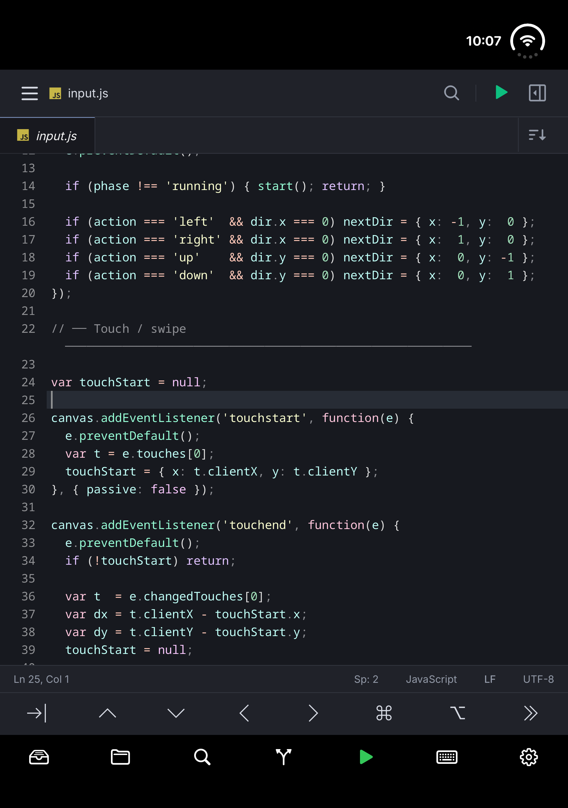
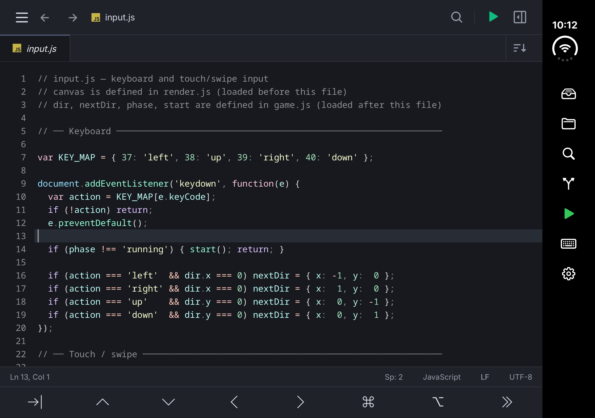
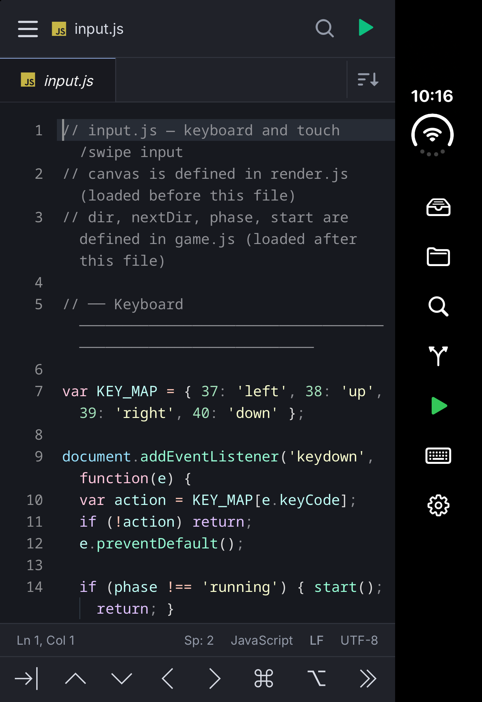
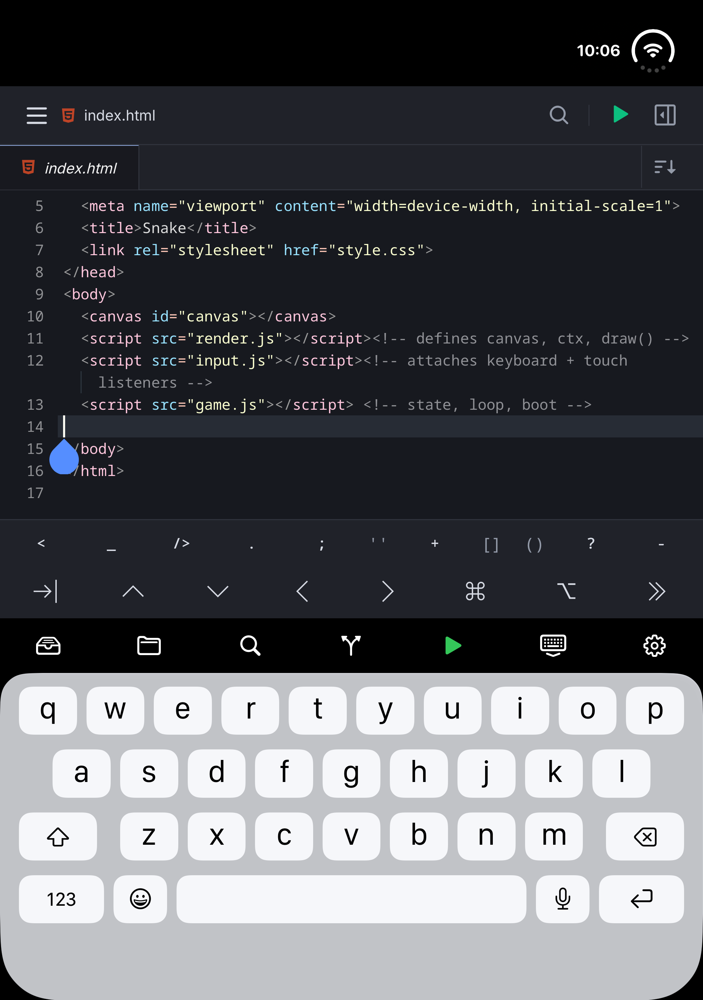

# iPhone Duo Support in Lite

Spck Editor Lite for iOS includes iPhone Duo support. The editor adjusts its available space as you fold or unfold the device, rotate the screen, and show or hide the on-screen keyboard. Duo controls appear automatically when the app detects the device.

## Action Bar

*Open Duo in portrait: the bottom action bar keeps common tools within reach.*

The Duo action bar provides shortcuts to common tools:

| Control | Action |
| --- | --- |
| Projects | Open the project workspace. |
| Files | Open the current project's file browser. Tap again to close the panel. |
| Search | Open project search. Tap again to close the panel. |
| Source Control | Open the Git panel. Tap again to close the panel. |
| Run | Save the current file and launch the project's preview. |
| Show / Hide Keyboard | Focus the editor to show the keyboard, or dismiss the keyboard. |
| Settings | Open app settings. |

Controls are enabled according to the current view and project. Open a project to use its Files, Search, and Source Control tools. Run is available when the current project and view support launching a preview.

## Folding and Rotation

When Duo is open in portrait orientation, the action bar runs along the bottom of the editor. In landscape orientation or when the device is folded closed, the controls use a vertical bar at the side. The bar can scroll when space is limited.

Continue using the same project as you change posture. The editor resizes to the space provided by iOS, accounting for safe areas and the action bar.

### Open in Landscape

*Open Duo in landscape: the action bar moves to the right side.*

### Folded Closed

*Folded Duo: editing continues on the outer display with the side action bar.*

## On-Screen Keyboard

Showing the docked keyboard reduces the available editor height. In open portrait orientation, the action bar sits above the keyboard. Use **Hide Keyboard** to regain editing space, and **Show Keyboard** to resume typing.

*Typing in open portrait: the editor resizes and the action bar stays above the keyboard.*

Folding the device does not create a separate editor boundary at the fold or attach the keyboard to it; the layout follows the space provided by iOS.

## Availability

These controls are specific to the iOS Lite app on iPhone Duo. They activate through native device detection; a wide screen alone does not enable them.

Lite's purchase and subscription rules still apply. Local editing features are included with the one-time app purchase; Remote Projects require a Spck account and an active subscription. See [Spck Editor Lite](./editor-lite) for the full feature list and Remote Projects details.
